# Obsidian Plugin Toolkit

A pnpm monorepo of Obsidian plugins: forks that fix what bothered me in community plugins ("(Enhanced)"), and plugins of my own that make Obsidian behave more like VS Code.

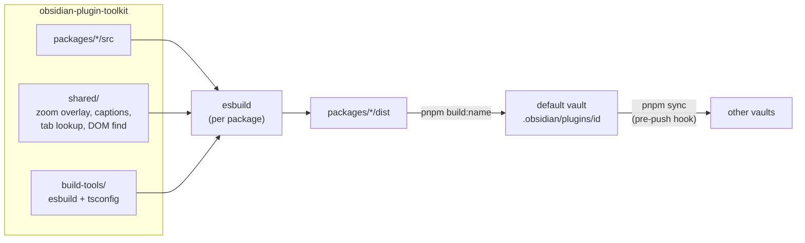

## Plugins at a glance

| Area | Plugin | What it's for |
|---|---|---|
| Writing | [Paste (Enhanced)](#paste-enhanced) | Paste HTML as Markdown, code as-is in code blocks |
| | [Auto Link Title (Enhanced)](#auto-link-title-enhanced) | A pasted URL becomes `[title](url)` |
| | [Image Auto Upload (Enhanced)](#image-auto-upload-enhanced) | Pasted images go to an image host via PicGo |
| | [Blockier (Enhanced)](#blockier-enhanced) | Block selection, callout and code-fence suggestions, code block indentation |
| | [Drafts](#drafts) | VS Code's untitled files |
| | [Note Comments](#note-comments) | Comments on selected text, kept out of the Markdown |
| | [Sticky Find](#sticky-find) | Find in a note without breaking rendered tables |
| | [Line Numbers](#line-numbers) | Line numbers on every line |
| | [Word Count (Enhanced)](#word-count-enhanced) | The status bar's word count says when it counts the selection |
| Figures | [Caption (Enhanced)](#caption-enhanced) | Captions under images, Mermaid and Excalidraw |
| | [Mermaid (Enhanced)](#mermaid-enhanced) | Diagrams that fit the screen, zoom overlay |
| | [Excalidraw (Enhanced)](#excalidraw-enhanced) | Drawings that behave like Mermaid diagrams |
| | [Sticky Table Header](#sticky-table-header) | Table headers stay pinned while scrolling |
| Navigation | [Quick Open](#quick-open) | `Cmd+P` Go to File |
| | [Nav History](#nav-history) | Global Go Back / Go Forward |
| | [Sticky Heading](#sticky-heading) | The section in view, after the title in the tab header |
| | [Tab Manager](#tab-manager) | A link to an open note goes to its tab |
| | [Sidebar Guard](#sidebar-guard) | `Cmd+W` never closes a sidebar panel |
| | [File Explorer (Enhanced)](#file-explorer-enhanced) | Pins, folder notes, hidden files |
| | [Hide UI Elements](#hide-ui-elements) | Hide sidebar tabs and status bar items |
| | [Copy Path](#copy-path) | Copy a note's absolute path |
| AI | [Claudian (Enhanced)](#claudian-enhanced) | Claude Code in the sidebar, a conversation per note |
| Vault | [Vault Backup](#vault-backup) | Scheduled git commit + push, from one machine only |

Every package lives in `packages/<name>/`. Shared runtime code lives in `shared/`, which esbuild bundles into each plugin that uses it.

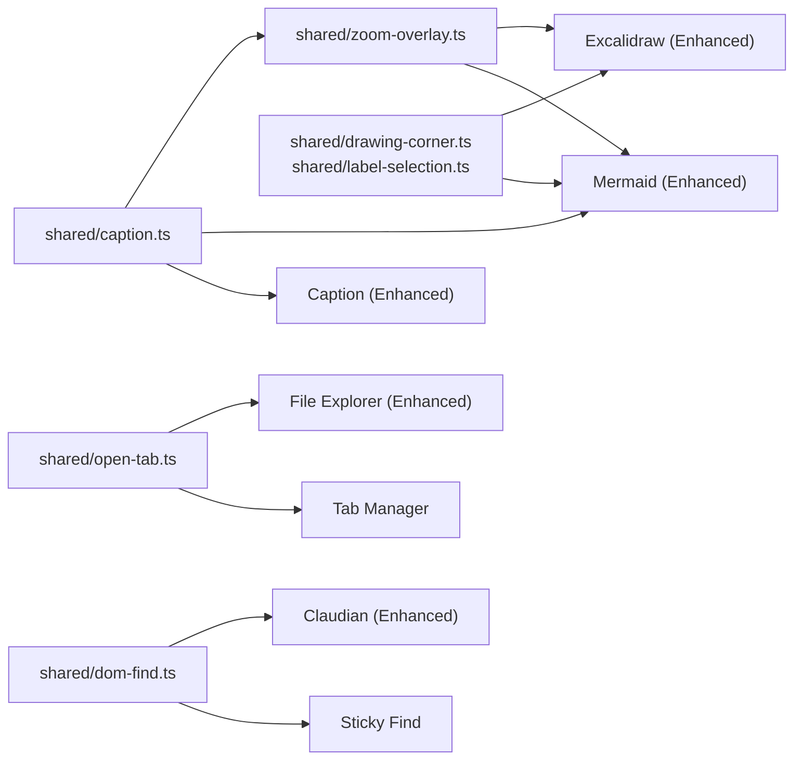

## Writing

### Paste (Enhanced)

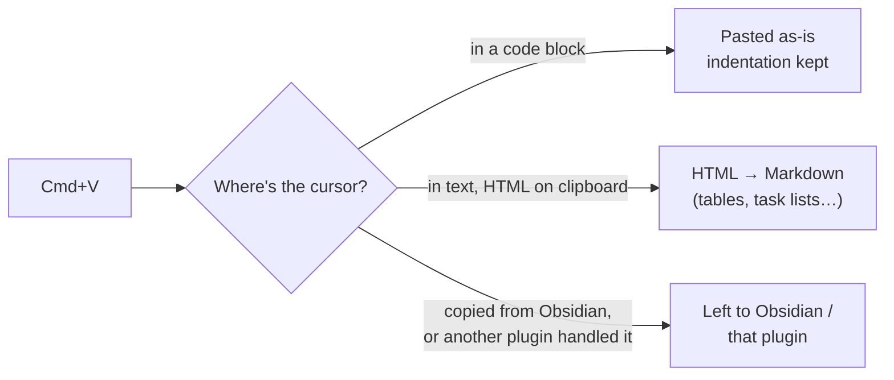

Pastes according to the cursor's context. Rich HTML from a browser or document becomes clean GitHub-flavored Markdown. Inside a code block, text keeps its exact indentation and line breaks. Text copied out of a note goes back through Obsidian's own paste, so embeds, wikilinks and callouts survive. A paste another plugin already handled, such as an image upload or a link title, isn't processed twice. The patch version bumps itself on every build.

### Auto Link Title (Enhanced)

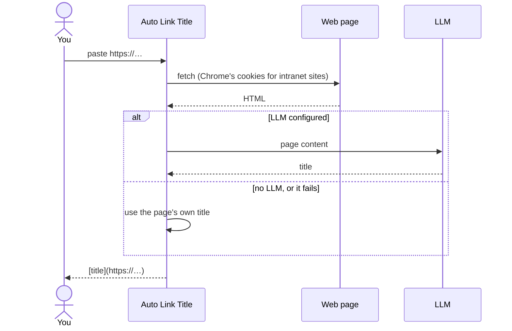

A pasted link becomes `[title](url)`. By default an OpenAI-compatible LLM writes the title from the page, falling back to the page's own `<title>`. Intranet pages are fetched with Chrome's cookies for that site, and pages that aren't UTF-8 decode correctly. A URL pasted into an image's alt text is left alone.

### Image Auto Upload (Enhanced)

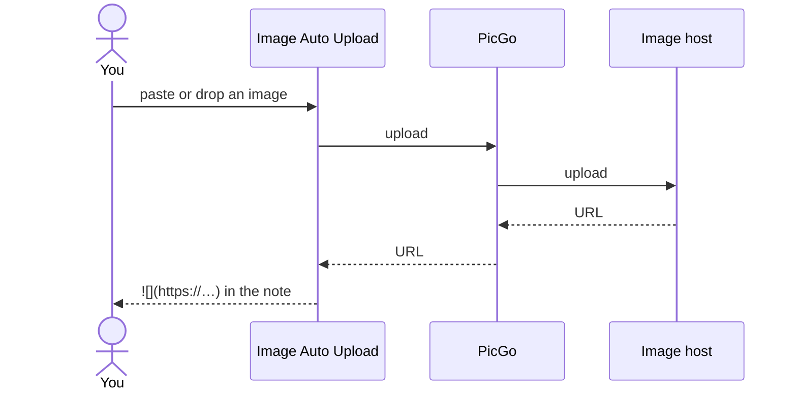

Uploads images from the clipboard through PicGo and writes the hosted link into the note.

### Blockier (Enhanced)

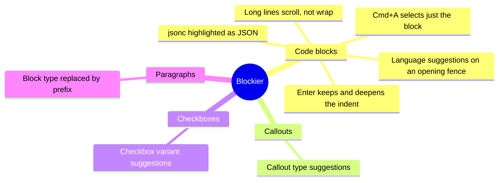

Block editing utilities, forked from Blockier:

- **Select block**: `Cmd/Ctrl+A` inside a code block selects just that block, and pressing it again selects the whole note.
- **Code fence suggestions**: typing an opening fence (```` ```py ````) suggests the language. Exact matches come first, then prefix, then fuzzy, each ordered by how often the vault's code blocks use it, aliases (`ts`, `js`, `py`, `sh`, `yml`…) included. Enter, Tab or a click writes it and puts the cursor inside the block, with an optional per-language template. ```` ``` ```` + Enter still makes a plain block.
- **Code block indentation**: Enter keeps the line's indent. It goes a level deeper after an opening bracket, or after a colon ending a Python or YAML line, and between a pair of brackets the closer moves to its own line. The indent unit is the block's own (a tab, or its fewest leading spaces).
- **`jsonc` code blocks** are highlighted as the JSON they are, comments included, in the editor and Reading view alike; Obsidian knows no `jsonc` and showed them as plain text.
- **Callout and checkbox suggestions**, and block-type replacement by prefix.
- Rendered code blocks scroll sideways instead of wrapping (a setting, on by default).

### Drafts

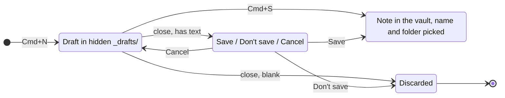

VS Code's untitled files. "New draft" opens a blank note that isn't anywhere in the vault yet, so jotting something down no longer leaves an `Untitled.md` behind.

- `Cmd/Ctrl+S` in a draft asks for a name (its first line, to start with) and a folder, and moves it there with its links and attachments.
- Closing a draft with text in it asks Save / Don't save / Cancel. A blank one is just discarded, and one left behind any other way is reopened with "Open draft…".
- Drafts are real notes in a hidden `_drafts/` folder, so every editor plugin works in them. The folder is hidden from the file explorer, search and graph, and left out of Vault Backup.
- On mobile a draft's header has a save button instead of `Cmd/Ctrl+S`.

### Note Comments

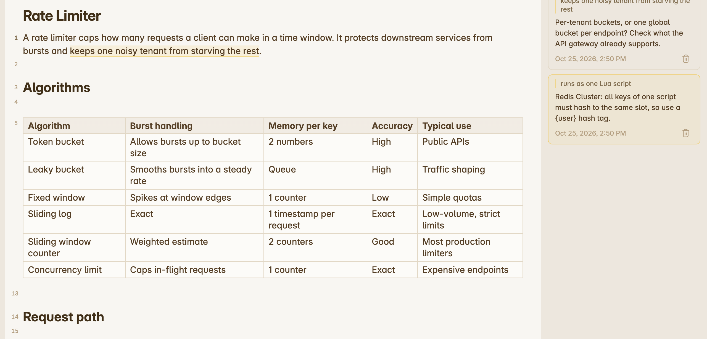

Comment on selected text without touching the Markdown. Commented passages are highlighted, and hovering shows the comment in a small card. Clicking one opens the Comments panel, where comments are written in a full Obsidian editor, so images, Mermaid and paste handlers work there too. A comment is found again by its quoted text and surrounding context, ignoring whitespace, Markdown markup and punctuation, so reformatting a note doesn't lose it. One whose words were rewritten stays in the panel, marked as not found. Selecting a comment's text also sends it to Claudian.

### Sticky Find

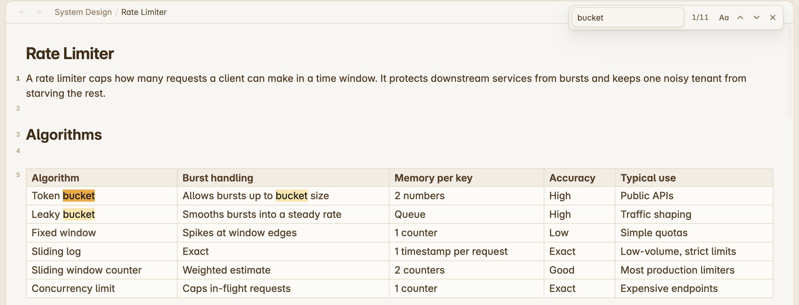

Find in the current note without collapsing rendered tables. The built-in find moves the editor selection into the match, which forces Live Preview to fall back to Markdown source; this one highlights matches without moving the selection.

### Line Numbers

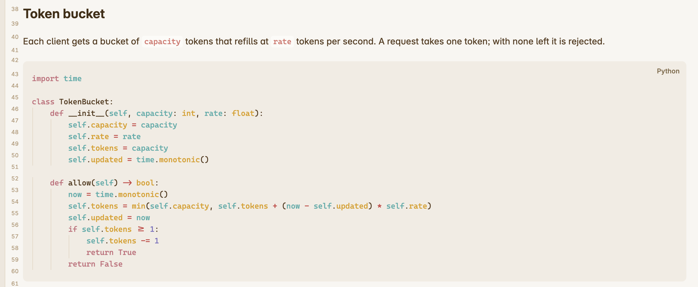

Whole-document line numbers in the editor gutter, with an option to float them in the left margin. A block Live Preview draws in place of its lines gets them numbered too, not just its first: a table on every row, a callout on every line, level with its text (a folded one's hidden lines stay unnumbered, as a folded heading's do), and a diagram, math or HTML block — a picture, with no place in it for the lines between — its first line at its top and its last at its bottom.

### Word Count (Enhanced)

Obsidian's word count in the status bar counts the selection while text is selected in the editor, else the whole note, and reads the same either way. This adds "selected" to a count of the selection: `5 words selected`, as against `16,392 words`.

## Figures

### Caption (Enhanced)

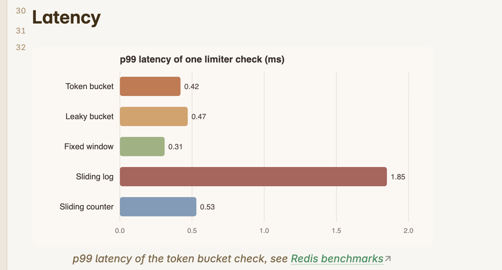

Captions under images, Mermaid diagrams and Excalidraw drawings, in Live Preview and Reading view. The caption is the image's alt text in plain Markdown, so links and emphasis in it render. Live Preview can't parse a link inside an alt, so this plugin draws those images itself. A caption button among an image's actions edits it; the same caption UI (`shared/caption.ts`) is used by Mermaid (Enhanced) and the zoom overlay. An image's edit button stays pinned to its top-right corner after resizing.

### Mermaid (Enhanced)

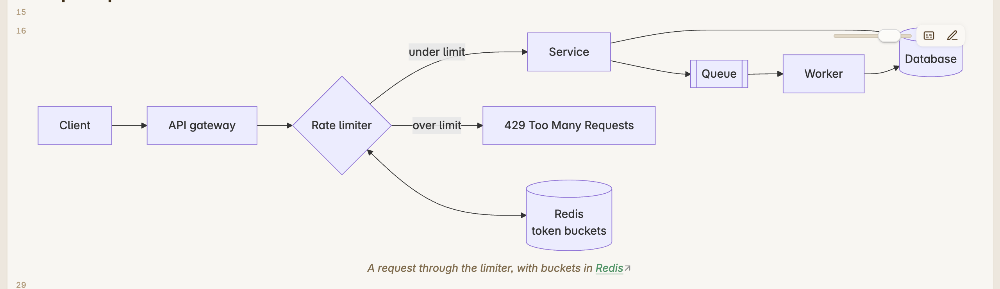

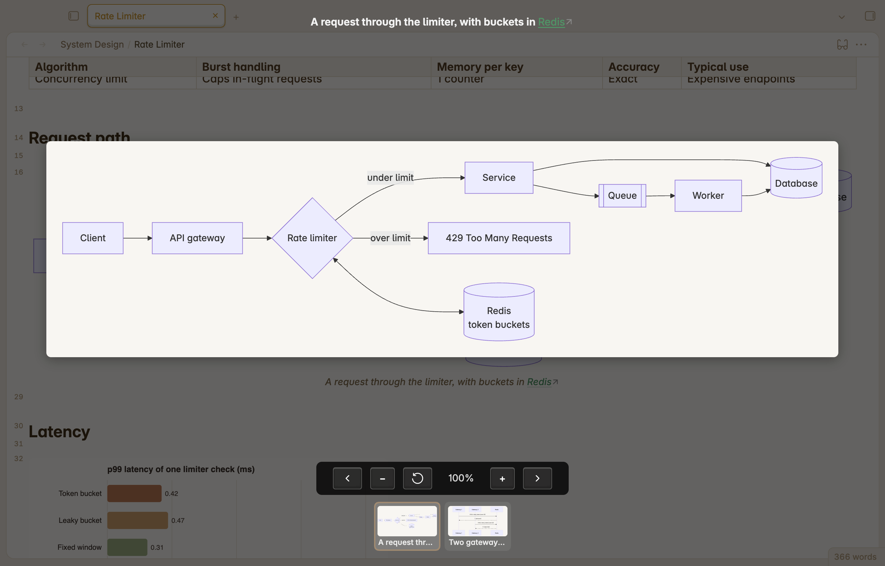

- Tall diagrams fit one screen, with a per-diagram size slider saved as `%% fit: … %%`, and are never wider than the note.
- Captions as `%% caption: … %%`, edited and rendered like image captions.
- In Live Preview a diagram stays a diagram: the cursor stays out of it unless you press its edit button or type in it. Its action group (caption, zoom in, edit) sits on the diagram's own top-right corner and shows on hovering the diagram, as an image's does.
- Dragging across a label selects it line by line, the way text does; Chromium put the end of a drag in a multi-line label by how far across the pointer was, on whichever line.
- It zooms as an image does: a click selects it (ring, zoom-in cursor), a second click — or `Cmd/Ctrl`-click, or the zoom-in button — opens a zoomable, pannable overlay that pages through every diagram of the note (thumbnails, ←/→; ones with a syntax error are skipped), with selectable labels and the caption as its title.

### Excalidraw (Enhanced)

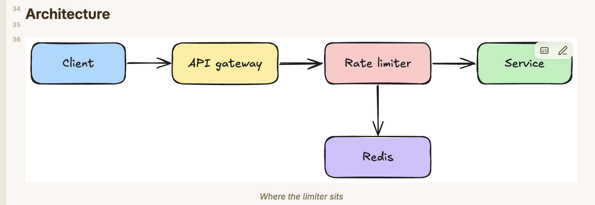

- Embedded drawings render centred at the width in settings, never wider than the note. A size slider by the drawing's buttons, as on a Mermaid diagram, sizes one to a share of the window's height or the note's full width, kept in the drawing's `excalidraw-enhanced-fit` property.
- It zooms as Mermaid does: click to select, click again, `Cmd/Ctrl`-click or the zoom-in button to open the same overlay. While zooming, a bitmap stands in for a heavy SVG and the vector comes back once you stop, so large hand-drawn drawings zoom smoothly.
- Text in a drawing (shown as SVG) can be selected by dragging, line by line, as in a Mermaid label.
- An edit button (like Mermaid's) opens the drawing in a new tab and goes to it. Single clicks, double clicks and right-clicks no longer open the drawing by accident; right-click shows a menu for the drawing.
- Opening a drawing folds the right sidebar away, once; after that the sidebar is left as you set it. Excalidraw's hints under its toolbar are hidden, and the keys it names take the drawing's colours, not Obsidian's dark ones.
- Typing ```` ```excalidraw ```` makes a new drawing and embeds it.
- Images in Claudian's replies zoom too.

### Sticky Table Header

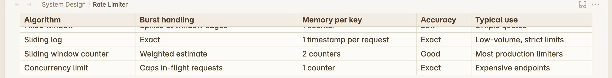

Keeps table headers pinned while scrolling, in Reading view and Live Preview, without breaking cell drag-selection.

## Navigation

### Quick Open

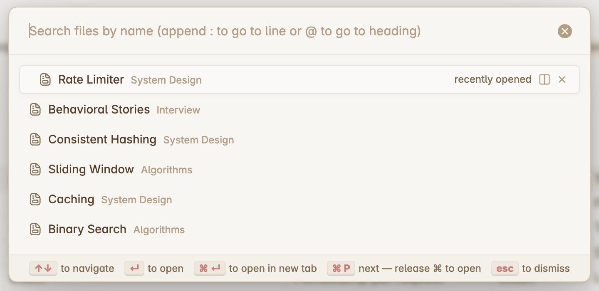

VS Code's Go to File on `Cmd/Ctrl+P` (the command palette moves to `Cmd/Ctrl+Shift+P`).

- With nothing typed it lists recently opened files. Typing fuzzy-matches file names (or whole paths once the query has a `/`) and notes' `aliases`, recent matches first.
- `name:42` opens at a line, `:42` goes to a line in the current note, `@` lists its headings.
- Enter opens in the tab the file already has, or a new tab, never over the note you're in. `Cmd/Ctrl+Enter` always opens a new tab. Holding `Cmd/Ctrl` and pressing `P` again moves down the list; letting go opens the selection.
- The recent list syncs between devices through `data.json`, merged entry by entry, so one device never overwrites another's.
- An empty new tab becomes the same search inline. On mobile it takes over the navbar's search button.

### Nav History

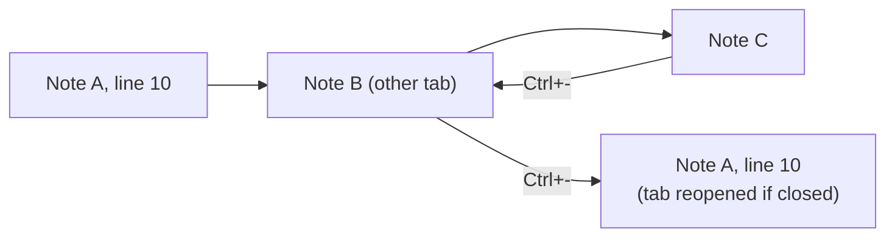

VS Code style global Go Back / Go Forward (`Ctrl+-` / `Ctrl+Shift+-`). Obsidian's own history is per tab; this keeps one stack for the whole workspace, restores the exact cursor position, and reopens a tab that was closed rather than taking over the one you're looking at.

### Sticky Heading

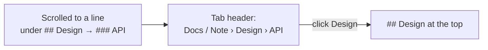

Shows the section you've scrolled to after the note's title in the tab header, as VS Code's breadcrumbs and sticky scroll do: the last heading at or above the top line, and each heading it's under. It follows the scroll in Live Preview, Source and Reading view. Clicking a heading scrolls it back to the top; the cursor stays put.

### Tab Manager

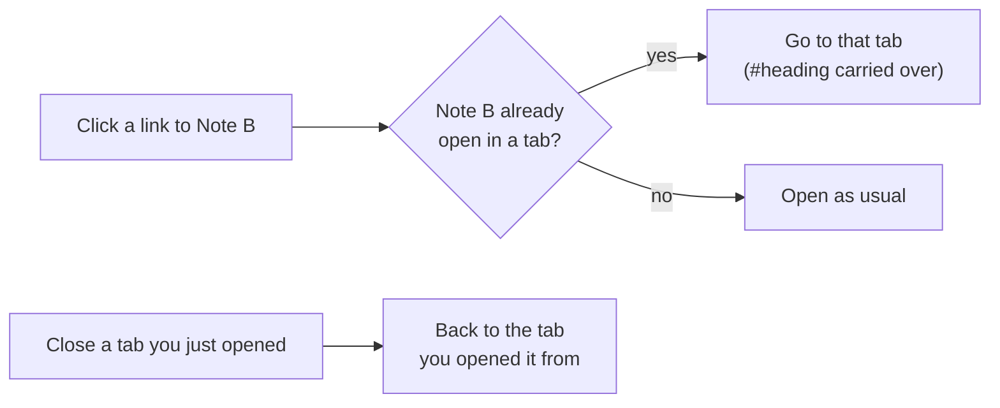

Following a link to a note that's already open goes to its tab instead of opening it again, as the Chrome extension of the same name does for web pages. That applies to a plain click, `Cmd/Ctrl`-click and middle click alike. A link's `#heading` or `#^block` is carried over to the tab it lands on. Closing a tab you just opened goes back to the tab you opened it from. File Explorer (Enhanced) applies the same rule to the file tree through `shared/open-tab.ts`.

### Sidebar Guard

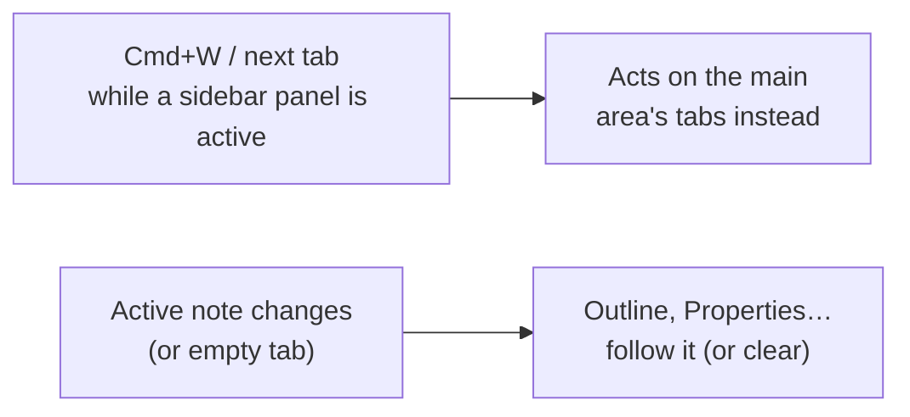

- `Cmd/Ctrl+W` never closes a sidebar panel (Claudian, Outline, Graph…). With a panel active it closes your tab in the main area instead, as in VS Code. A note opened in a sidebar still closes as usual.
- "Go to next/previous tab" likewise cycles the main area's tabs while a panel is active.
- It wraps the commands rather than the keys, so it follows whatever hotkeys they have.
- Panels that show the active note (Outline, Properties, local graph…) are kept on it, and clear over an empty tab or a main-area Claudian chat.

### File Explorer (Enhanced)

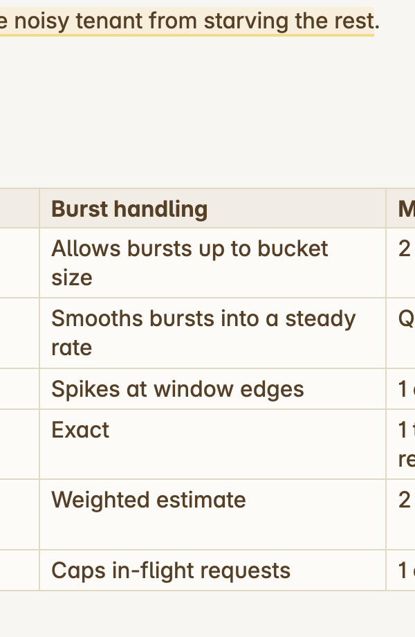

Pinned items, folder notes, file counts and hiding files or folders (right-click, wildcard patterns, a toggle-visibility command). An open folder note highlights its folder, and "Reveal current file in navigation" (`Cmd/Ctrl+Shift+E`) flashes the folder. "Reveal in Finder" shows the row last clicked in the tree. `Cmd/Ctrl+B` in the tree toggles the left sidebar.

### Hide UI Elements

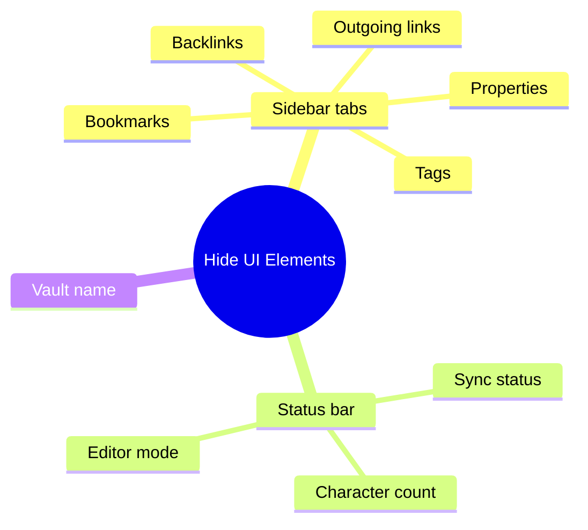

Toggles the visibility of sidebar tabs (Tags, Bookmarks, Backlinks, Outgoing links, Properties…) and status bar items. Also sizes the modal close button under the Primary theme.

### Copy Path

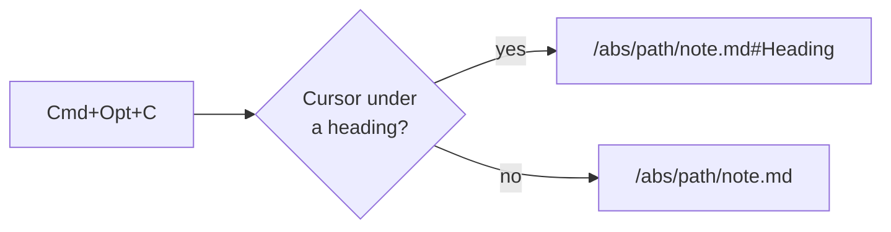

Copies the absolute path of the current file, optionally with the current heading as an anchor.

## AI

### Claudian (Enhanced)

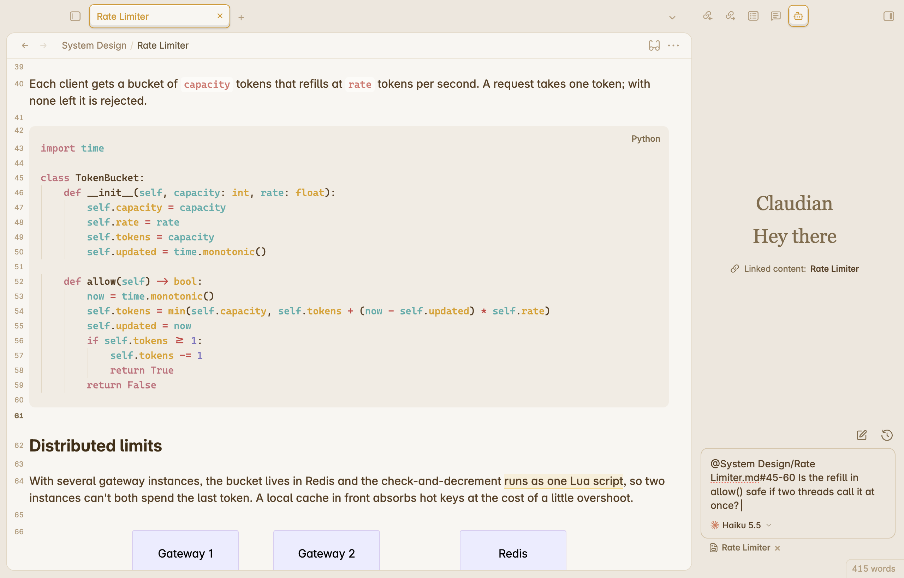

[Claudian](https://github.com/YishenTu/claudian), tuned for notes.

- `Cmd/Ctrl+L` toggles the chat, focusing its input and keeping the editor selection highlighted.
- Each note keeps its own conversation: switching notes brings back that note's conversation and reading position. A reply still running carries on in its own tab. A chat opened in the main area isn't bound to any note.
- `Option/Alt+K` puts a reference to the selection into the composer (`@path#lines`), as Claude Code's VS Code extension does. Selections from rendered tables, Mermaid diagrams, Excalidraw drawings and comments count. References in prompts and replies are links that open the note at those lines.
- Every prompt is tagged with the note lines it was sent with. The current prompt stays pinned while its reply scrolls, and streaming follows the bottom until you scroll up.
- Images pasted or dropped into the composer show as thumbnails in their chips, not just "Image 1", "Image 2".
- `Cmd/Ctrl+N` starts a new session when you're in Claudian, else a new draft. `Cmd/Ctrl+F` finds in the conversation.
- Long conversations stay light: replies out of sight aren't laid out or painted until you scroll near them, so a streaming reply or a resized panel no longer re-lays out the whole conversation.

## Vault

### Vault Backup

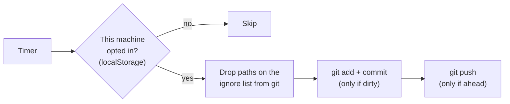

Commits and pushes the vault with git on a schedule. Backup only runs on machines you explicitly opt in (the switch lives in Obsidian's per-machine localStorage, not the iCloud-synced `data.json`), so a vault shared across several computers is only ever written by one of them. An ignore list keeps noisy files out: plugin build output, Claudian sessions, drafts, and the `data.json` of plugins that only store state (Recent Files, Quick Open, Claudian (Enhanced)). Failures show in the status bar, a notice and the settings page.

## Development

```bash
pnpm install
pnpm dev                    # watch mode for every package, symlinked into the vault
pnpm dev:<name>             # one package, e.g. pnpm dev:caption-enhanced
pnpm build                  # type-check + production build of every package
pnpm build:<name>           # one package, copied into OBSIDIAN_PLUGINS_DIR
pnpm lint
```

`<name>` is the package directory under `packages/`. Set `OBSIDIAN_PLUGINS_DIR` in `.env` (see `.env.example`) to the vault's `.obsidian/plugins`.

### Sync to other vaults

`pnpm build:<name>` copies a plugin into the vault set by `OBSIDIAN_PLUGINS_DIR`. `pnpm sync` (`node scripts/sync-vaults.mjs [vault…]`) then mirrors every built plugin into the other vaults, matched by manifest `id`, with each vault's own `data.json` kept. It also copies CSS snippets, the shared app / appearance / hotkey / core-plugin settings, and Claudian's system prompt (only the prompt; model, permission mode and the rest stay per vault). The `.githooks/pre-push` hook runs it on every push (skip with `git push --no-verify`), so build before pushing.

### Plugin IDs, folders and versions

- A package builds into `packages/<name>/dist/`, which is copied into the vault folder named after its manifest `id`. The name comes from `manifest.json`, so it can't drift.
- Obsidian's plugin updater knows a plugin by its `id` alone and offers the community store's release of the same id as an update, which would replace ours. So some ids carry a prefix (`yeyan-drafts`, `yeyan-quick-open`, `yeyan-sidebar-guard`, `yeyan-tab-manager`), and the ids the store also has but we keep are versioned `100.0.0`, so no store release is ever newer: `copy-path`, `note-comments`, `vault-backup`. Check a new plugin's id against [community-plugins.json](https://github.com/obsidianmd/obsidian-releases/blob/master/community-plugins.json) before choosing it.

### Shared configuration

- **esbuild**: every package calls `createBuildContext()` from `build-tools/esbuild.config.mjs` with a few lines of its own.
- **TypeScript**: every package extends `build-tools/tsconfig.base.json` (strict).
- **Versions**: `pnpm version patch` in a package runs `build-tools/version-bump.mjs`.
- **Stack**: pnpm workspace, TypeScript 5.8, esbuild 0.25, ESLint 9 with `typescript-eslint` and `eslint-plugin-obsidianmd`.
